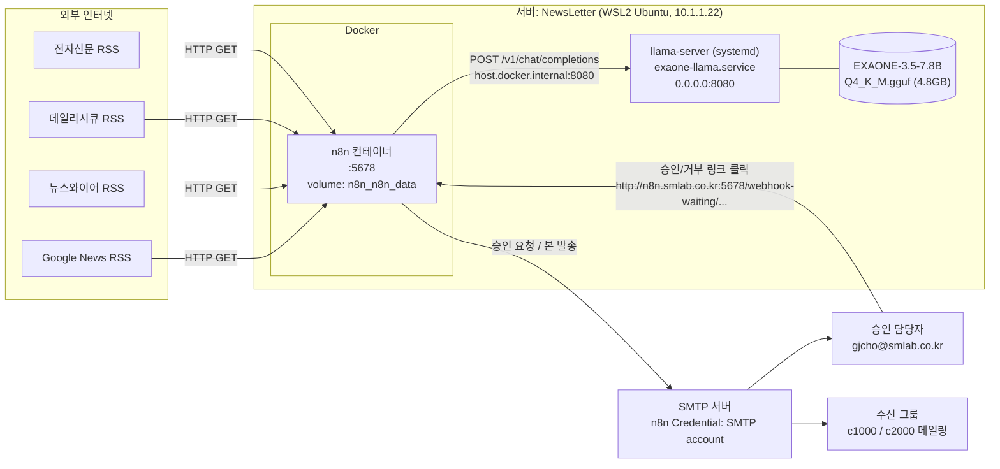
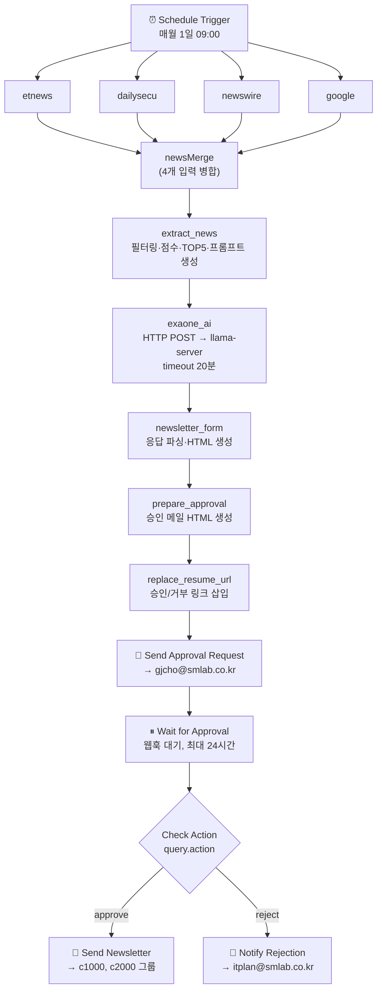
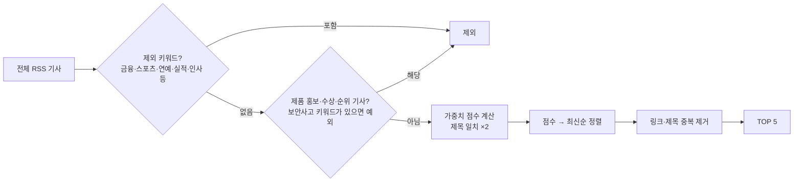
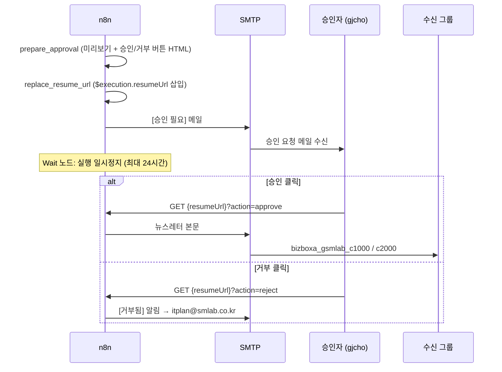

# 보안 뉴스레터 자동 발송 시스템 아키텍처

> n8n + EXAONE 3.5 (llama.cpp) 기반 월간 정보보안 뉴스레터 생성·승인·발송 시스템
> 작성 기준일: 2026-09-28 (서버 `NewsLetter` 실측 기준)

---

## 1. 개요

매월 1일 09:00(KST)에 보안 관련 RSS 뉴스를 수집하고, 키워드 점수로 TOP 5 기사를 고른 뒤, 사내 서버에서 동작하는 로컬 LLM(EXAONE 3.5 7.8B)으로 요약과 의료 환경 관점의 시사점을 만듭니다. 결과는 HTML 뉴스레터로 만들어져 **담당자 승인 메일**로 먼저 전달되며, 담당자가 승인하면 사내 전체 메일링 그룹으로 발송됩니다.

| 항목 | 내용 |
|---|---|
| 워크플로 엔진 | n8n 2.5.0 (Docker 컨테이너) |
| LLM | LG AI EXAONE-3.5-7.8B-Instruct, GGUF Q4_K_M 양자화 |
| LLM 서빙 | llama.cpp `llama-server` (build 7942 / `af252d075`), CPU 전용 |
| 실행 방식 | 월 1회 스케줄 + 이메일 승인(Human-in-the-loop) |
| 외부 의존 | RSS 피드 4종, SMTP 서버 |

---

## 2. 전체 구성도



### 2.1 네트워크 경로

| 구간 | 주소 | 비고 |
|---|---|---|
| 사용자 → n8n 편집기/웹훅 | `http://n8n.smlab.co.kr:5678` | `N8N_EDITOR_BASE_URL`, `WEBHOOK_URL` |
| n8n 컨테이너 → llama-server | `http://host.docker.internal:8080` | compose의 `extra_hosts: host-gateway`로 호스트에 연결 |
| llama-server 바인딩 | `0.0.0.0:8080` | 호스트의 모든 인터페이스에서 접근 가능 |
| 호스트 IP | `10.1.1.22` (eth), Docker 브리지 172.17~19.x | llama-server 로그에서 n8n 요청 출발지는 `172.18.0.2` |

---

## 3. 구성 요소

### 3.1 서버 (호스트)

| 항목 | 값 |
|---|---|
| 호스트명 | `NewsLetter` |
| OS | Ubuntu on WSL2 (kernel 6.6.87.2-microsoft-standard-WSL2), `systemd=true` |
| CPU | Intel Xeon Silver 4208 @ 2.10GHz, 6 vCPU |
| 메모리 | 11 GiB (+ swap 4 GiB) |
| GPU | 없음 (CPU 추론) |
| 디스크 | `/` 1TB (사용 약 2%) |
| 실행 계정 | `itplan` (docker 그룹 소속) |

### 3.2 디렉터리 구조

```
/home/itplan/
├── llama.cpp/                      # llama.cpp 소스 (github.com/ggerganov/llama.cpp)
│   └── build/bin/llama-server      # cmake Release 빌드 결과물 (CPU 백엔드)
└── sec-newsletter/
    ├── models/
    │   └── EXAONE-3.5-7.8B-Instruct-Q4_K_M.gguf   # hf download로 받은 모델
    └── n8n/
        └── docker-compose.yml      # n8n 컨테이너 정의

/etc/systemd/system/exaone-llama.service   # LLM 서버 서비스 유닛
```

### 3.2.1 저장소 구성

| 경로 | 내용 |
|---|---|
| `ARCHITECTURE.md` | 이 문서 |
| `n8n/docker-compose.example.yml` | n8n compose 템플릿 (`N8N_ENCRYPTION_KEY`는 placeholder, 실제 키로 바꿔 `docker-compose.yml`로 저장) |
| `n8n/workflows/prd-security-newsletter.json` | 보안 뉴스레터 워크플로 export (자격증명 값 미포함, 가져온 뒤 SMTP 자격증명 재연결 필요) |
| `systemd/exaone-llama.service` | LLM 서버 systemd 유닛 |

모델 파일(`models/`)과 실제 운영 compose(`n8n/docker-compose.yml`)는 `.gitignore`로 제외됩니다.

### 3.3 LLM 서버: `exaone-llama.service`

llama.cpp의 `llama-server`가 OpenAI 호환 API(`/v1/chat/completions`)를 제공합니다.

```ini
[Service]
User=itplan
WorkingDirectory=/home/itplan/llama.cpp
Environment="MODEL_PATH=/home/itplan/sec-newsletter/models/EXAONE-3.5-7.8B-Instruct-Q4_K_M.gguf"
ExecStart=/home/itplan/llama.cpp/build/bin/llama-server \
    --model ${MODEL_PATH} --host 0.0.0.0 --port 8080 \
    --ctx-size 8192 --n-gpu-layers 0 --threads 6
Restart=on-failure
RestartSec=10
```

| 파라미터 | 값 | 의미 |
|---|---|---|
| `--ctx-size` | 8192 | 컨텍스트 창 (모델 학습 최대치는 32768) |
| `--n-gpu-layers` | 0 | GPU 미사용 |
| `--threads` | 6 | vCPU 전체 사용 |
| 재시작 정책 | on-failure, 10초 후 | 비정상 종료 시 자동 재기동 |

**실측 성능** (2026-09-02 실행 로그):

| 단계 | 토큰 | 속도 | 소요 |
|---|---|---|---|
| 프롬프트 처리 | 1,112 | 약 9 tok/s | 약 2분 |
| 응답 생성 | 1,223 | 약 3 tok/s | 약 7분 |
| **합계** | 2,335 | | **약 9분** |

상주 메모리는 약 8.3 GB(최대 10.5 GB)이며, 호스트 메모리 11 GiB 대부분을 차지합니다.

상태 확인:
```bash
sudo systemctl status exaone-llama.service
curl http://localhost:8080/health          # {"status":"ok"}
curl http://localhost:8080/v1/models
journalctl -u exaone-llama.service -f
```

### 3.4 n8n: `docker-compose.yml`

| 항목 | 값 |
|---|---|
| 이미지 | `docker.n8n.io/n8nio/n8n:2.5.0` |
| 컨테이너명 | `n8n` |
| 포트 | `5678:5678` |
| 데이터 볼륨 | `n8n_data` → `/home/node/.n8n` (실제 볼륨명 `n8n_n8n_data`, 기본 SQLite DB·자격증명 저장) |
| 타임존 | `GENERIC_TIMEZONE=Asia/Seoul`, `TZ=Asia/Seoul` |
| 외부 URL | `N8N_EDITOR_BASE_URL` / `WEBHOOK_URL` = `http://n8n.smlab.co.kr:5678` |
| 쿠키 | `N8N_SECURE_COOKIE=false` (HTTP 접속 허용) |
| 암호화 키 | `N8N_ENCRYPTION_KEY` (자격증명 암호화용, compose 파일에 기재) |
| 호스트 연결 | `extra_hosts: host.docker.internal:host-gateway` |
| 재시작 정책 | `unless-stopped` |

> `N8N_ENCRYPTION_KEY`를 잃어버리면 볼륨에 저장된 SMTP 자격증명을 복호화할 수 없습니다. 키는 별도로 안전하게 보관하세요.

운영 명령:
```bash
cd ~/sec-newsletter/n8n
docker compose ps
docker compose down && docker compose up -d
docker logs n8n --tail 50 -f
```

같은 n8n 인스턴스에서 다른 워크플로도 실행되지만, 이 중 LLM(8080)을 쓰는 것은 보안 뉴스레터뿐입니다.

| 워크플로 | 활성 | LLM 사용 |
|---|---|---|
| **prd-보안 뉴스레터** | ✅ | ✅ |
| 경쟁사 news | ✅ | - |
| 나라장터 메일 발송 | ✅ | - |
| 나라장터 | - | - |
| CRM 자동발송 | - | - |

---

## 4. 워크플로: `prd-보안 뉴스레터`

워크플로 ID: `ADvWVxd8v86pU7mYRxVTa` (활성)

### 4.1 노드 흐름



### 4.2 RSS 수집 소스

| 노드 | 출처 | URL |
|---|---|---|
| `etnews` | 전자신문 | `http://rss.etnews.com/04045.xml` |
| `dailysecu` | 데일리시큐 (많이 본 기사) | `https://www.dailysecu.com/rss/clickTop.xml` |
| `newswire` | 뉴스와이어 산업 609 | `https://api.newswire.co.kr/rss/industry/609` |
| `google` | Google News 기술 섹션 (한국) | `https://news.google.com/rss/headlines/section/topic/TECHNOLOGY?hl=ko&gl=KR&ceid=KR:ko` |

### 4.3 기사 선별: `extract_news` (Code 노드, v5.2-grounded)



- **키워드 가중치 예시**: 랜섬웨어·제로데이 8, 유출·개인정보 7, 피싱·공급망·APT·해킹 6, 침해·악성코드 5, 취약점·CVE·계정·DDoS 4, 패치·보안사고 3, 클라우드·빅테크 2
- **본문 전처리**: HTML 제거 후 description과 content를 합치고, 기사당 최대 1,800자로 자름 (소형 모델의 환각 억제 목적)
- 선별된 기사가 0건이면 빈 결과를 반환하며, 이후 노드는 실행되지 않음(발송 없음)

**LLM 요청 설계 (환각 억제)**

| 항목 | 내용 |
|---|---|
| System 프롬프트 | 20년차 보안 뉴스 요약 전문가 역할, `source_text` 밖의 정보 금지, 근거가 없으면 "정보부족"으로 작성 |
| User 프롬프트 | 기사 5개 JSON(id, title, url, published_at, source_text) + 작성 규칙 |
| 출력 구조 | `articles[]` (id, title, summary_bullets 3개, evidence_quotes) + `monthly_insights` 3개 |
| 시사점 관점 | 환자정보 보호, 진료 연속성, 의료기기·협력사 보안, 계정·접근통제 중 2개 이상 포함 |
| 생성 파라미터 | `temperature: 0`, `max_tokens: 3500` |

### 4.4 LLM 호출: `exaone_ai` (HTTP Request 노드)

```
POST http://host.docker.internal:8080/v1/chat/completions
{
  "model": "exaone",
  "messages": [...],
  "temperature": 0,
  "max_tokens": 3500
}
timeout: 1,200,000 ms (20분)
```

### 4.5 뉴스레터 생성: `newsletter_form` (Code 노드)

1. LLM 응답에서 JSON 구조를 여러 방식으로 추출 (코드펜스 제거 → 직접 파싱 → 중괄호 매칭 → 전체 문자열 탐색)
2. JSON 파싱에 실패하면 번호 목록 형태의 일반 텍스트로 파싱
3. 기사 제목은 모델 출력이 일반 표기(`기사 N`)일 때 `extract_news`의 원본 제목으로 교체하고, 링크는 원본 URL을 사용
4. **시사점 보정**: 모델이 만든 시사점 중 의료 관련 문장이 2개 미만이면, 요약 키워드를 기반으로 규칙 기반 시사점 3개로 대체
5. 모든 텍스트를 HTML 이스케이프 처리한 뒤 카드형 HTML 생성
6. 제목: `[보안뉴스] {월}월 정보보안 뉴스레터`

### 4.6 승인 및 발송



| 메일 | From | To |
|---|---|---|
| 승인 요청 | itplan@smlab.co.kr | gjcho@smlab.co.kr |
| 뉴스레터 발송 | itplan@smlab.co.kr | bizboxa_gsmlab_c1000@smlab.co.kr, bizboxa_gsmlab_c2000@smlab.co.kr |
| 거부 알림 | itplan@smlab.co.kr | itplan@smlab.co.kr |

- 세 메일 노드 모두 n8n 자격증명 **`SMTP account`**를 사용합니다.
- 승인 링크는 `WEBHOOK_URL`(`http://n8n.smlab.co.kr:5678/`) 기준으로 만들어지므로, 승인자 PC에서 이 주소에 접속할 수 있어야 합니다.
- 24시간 안에 응답이 없으면 Wait 노드가 타임아웃으로 재개됩니다. 이때 `action` 값이 없어 approve/reject 어느 분기에도 해당하지 않으므로 **아무 메일도 발송되지 않습니다**.

---

## 5. 실행 타임라인 (매월 1일)

| 시각 (대략) | 단계 |
|---|---|
| 09:00 | 스케줄 실행, RSS 4종 수집 |
| 09:00 | 필터링, TOP 5 선정, 프롬프트 생성 (수 초) |
| 09:00 ~ 09:10 | EXAONE 추론 (실측 약 9분, 최대 허용 20분) |
| 09:10 | 승인 요청 메일 발송 |
| ~ 익일 09:10 | 승인 대기 (최대 24시간) |
| 승인 즉시 | 사내 그룹 발송 |

---

## 6. 운영 시 참고사항

| 구분 | 내용 |
|---|---|
| 구조화 출력 | `extract_news`는 `response_format`(JSON Schema)와 `top_p`를 만들지만, `exaone_ai` 노드의 요청 body에는 `model`·`messages`·`temperature`·`max_tokens`만 들어갑니다. 따라서 **llama-server에서 스키마 강제가 적용되지 않으며**, `newsletter_form`의 다단계 파서가 출력 형식 차이를 흡수하고 있습니다. |
| 응답 시간 | CPU 추론으로 약 3 tok/s. 기사 길이나 `max_tokens`를 늘리면 20분 타임아웃에 걸릴 수 있습니다. |
| 메모리 | llama-server가 약 8~10 GB를 사용합니다. 같은 호스트에서 무거운 작업을 동시에 돌리면 swap이나 OOM이 발생할 수 있습니다. |
| 동시성 | 월 1회 단일 요청이므로 문제는 없지만, 수동 실행과 스케줄 실행이 겹치면 추론이 순차 처리되어 지연됩니다. |
| 보안 | n8n이 HTTP(`N8N_SECURE_COOKIE=false`)로 노출되어 있고, llama-server가 인증 없이 `0.0.0.0:8080`에 바인딩되어 있습니다. 내부망 방화벽으로 접근을 제한해야 합니다. |
| 비밀정보 | `N8N_ENCRYPTION_KEY`가 compose 파일에 평문으로 들어 있습니다. 파일 권한 관리와 별도 백업이 필요합니다. |
| 수신자 변경 | 수신자와 승인자는 각 Send 노드에 직접 입력되어 있으므로 n8n 편집기에서 수정합니다. |
| 백업 대상 | Docker 볼륨 `n8n_n8n_data`, `docker-compose.yml`, `exaone-llama.service`, 모델 파일 |
| 로그 확인 | n8n: `docker logs n8n` / 편집기의 Executions 탭 · LLM: `journalctl -u exaone-llama.service` |

---

## 7. 재구축 절차 요약

```bash
# 1) 사전 설치 (WSL2: /etc/wsl.conf 에 [boot] systemd=true)
sudo apt install -y docker-ce docker-ce-cli containerd.io docker-compose-plugin cmake build-essential git python3-pip
sudo usermod -aG docker $USER
pip3 install huggingface_hub --break-system-packages

# 2) 모델 다운로드
mkdir -p ~/sec-newsletter/models
hf download LGAI-EXAONE/EXAONE-3.5-7.8B-Instruct-GGUF \
  --include "EXAONE-3.5-7.8B-Instruct-Q4_K_M.gguf" --local-dir ~/sec-newsletter/models

# 3) llama.cpp 빌드
git clone https://github.com/ggerganov/llama.cpp.git ~/llama.cpp
cd ~/llama.cpp && cmake -B build && cmake --build build --config Release -j $(nproc)

# 4) LLM 서비스 등록 (3.3절의 유닛 파일 작성 후)
sudo systemctl daemon-reload
sudo systemctl enable --now exaone-llama.service

# 5) n8n 기동 (3.4절의 compose 작성 후, 기존 암호화 키를 그대로 사용)
cd ~/sec-newsletter/n8n && docker compose up -d

# 6) n8n 편집기에서 SMTP 자격증명 등록 후 워크플로 import 및 활성화
```
